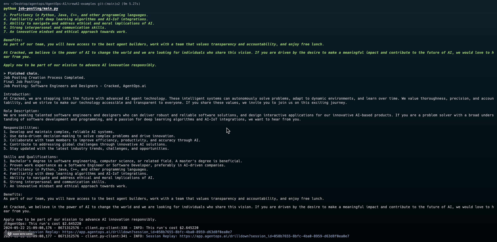

[//]: # (Card for video tutorial)
[//]: # (<Card title="REST Server + agentlens" icon="computer" href="https://www.loom.com/share/cfcaaef8d4a14cc7a974843bda1076bf">)

[//]: # (	Using agents in a REST server and observing)

[//]: # (	![thumbnail]&#40;https://cdn.loom.com/sessions/thumbnails/cfcaaef8d4a14cc7a974843bda1076bf-1713568618224-with-play.gif&#41;)

[//]: # (</Card>)

## Adding agentlens to Crew agents

<Steps>
	<Step title="Install the agentlens SDK">
		<CodeGroup>
			```bash pip
			pip install agentlens
			```
			```bash poetry
			poetry add agentlens
			```
		</CodeGroup>
	</Step>
	<Step title="Install Crew with agentlens">
		<CodeGroup>
			```bash pip
			pip install 'crewai[agentlens]'
			```
			```bash poetry
			poetry add 'crewai[agentlens]'
			```
		</CodeGroup>
	</Step>
	<Step title="Add 3 lines of code">
		1. Before calling the `Crew()` constructor in your code, call `agentlens.init()`
		2. At the end of your Crew run, call `agentlens.end_session("Success")`
		<CodeGroup>
			```python python
			import agentlens

			# Beginning of program (i.e. main.py, __init__.py)
			# IMPORTANT: Must be before calling the `Crew()` constructor
			agentlens.init(<INSERT YOUR API KEY HERE>)
			...
			# End of program (e.g. main.py)
			agentlens.end_session("Success") # Success|Fail|Indeterminate
			```
		</CodeGroup>
		<Check>
			Instantiating the agentlens client will automatically instrument Crew, meaning you will be able to see all
			of your sessions on the agentlens Dashboard along with the full LLM chat histories, cost, token counts, etc.
		</Check>
		<Tip>
			For more features see our [Usage](/v1/usage) section.
		</Tip>
	</Step>
	<Step title="Set your API key">
		Retrieve an API Key from your Settings > [Projects & API Keys](http://localhost:3000/settings/projects) page.
		<Frame type="glass" caption="Settings > Projects & API Keys">
			
		</Frame>
		<Info>
			API keys are tied to individual projects.<br></br>
			A Default Project has been created for you, so just click Copy API Key
		</Info>
		Set this API Key in your [environment variables](/v1/usage/advanced-configuration)
		```python .env
		AGENTLENS_API_KEY=<YOUR API KEY>
		```
	</Step>
    <Step title="Run your crew">
		Execute your program and visit [app.github.com/jeansvaldez/agentlens/drilldown](http://localhost:3000/drilldown) to observe your Crew! 🕵️
		<Tip>
			After your run, agentlens prints a clickable url to console linking directly to your session in the Dashboard
		</Tip>
		<div/>{/* Intentionally blank div for newline */}
		<Frame type="glass" caption="Clickable link to session">
			
		</Frame>
	</Step>
</Steps>

## Special Considerations with Crew
The Crew framework is capable of determining when all tasks have been accomplished and to halt execution. agentlens will automatically end your active session
when this determination is made. If you don't want your agentlens session to end at this time, add an optional parameter to your `agentlens.init()` call.

```python
agentlens.init(skip_auto_end_session=True)
```

## Crew + agentlens Examples

<CardGroup cols={3}>
    <Card title="Job Posting" icon="briefcase" href="https://github.com/Agentlens-AI/crewAI-examples/tree/main/job-posting" />
	<Card title="Instagram Post" icon="instagram" href="https://github.com/Agentlens-AI/crewAI-examples/tree/main/instagram_post" />
    <Card title="Markdown Validator" icon="markdown" href="https://github.com/Agentlens-AI/crewAI-examples/tree/main/markdown_validator" />
</CardGroup>