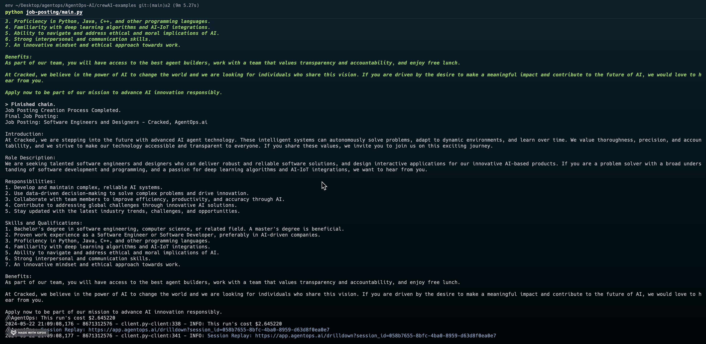

import CodeTooltip from '/snippets/add-code-tooltip.mdx'
import EnvTooltip from '/snippets/add-env-tooltip.mdx'

[CAMEL-AI](https://www.camel-ai.org/) is the first large language model (LLM) multi-agent framework and an open-source community dedicated to finding the scaling law of agents. Checkout their comprehensive documentation [here](https://docs.camel-ai.org/).

## Adding agentlens to CAMEL agents

<Steps>
	<Step title="Install the agentlens SDK">
		<CodeGroup>
			```bash pip
			pip install agentlens
			```
			```bash poetry
			poetry add agentlens
			```
		</CodeGroup>
	</Step>
	<Step title="Install CAMEL-AI with all dependencies">
		<CodeGroup>
			```bash pip
			pip install "camel-ai[all]==0.2.11"
			```
			```bash poetry
			poetry add "camel-ai[all]==0.2.11"
			```
		</CodeGroup>
	</Step>
	<Step title="Add agentlens code to your code">
		<CodeTooltip/>
			<CodeGroup>
				```python python
				import agentlens
				agentlens.init(<INSERT YOUR API KEY HERE>)

				# your code here

				agentlens.end_session("Success") # Success|Fail|Indeterminate
				```
			</CodeGroup>
		<EnvTooltip />
      <CodeGroup>
        ```python .env
        AGENTLENS_API_KEY=<YOUR API KEY>
        ```
      </CodeGroup>
      Read more about environment variables in [Advanced Configuration](/v1/usage/advanced-configuration)
	</Step>
	<Step title="Run your agent">
		Execute your program and visit [app.github.com/jeansvaldez/agentlens/drilldown](http://localhost:3000/drilldown) to observe your CAMEL Agent! 🕵️
		<Tip>
			After your run, agentlens prints a clickable url to console linking directly to your session in the Dashboard
		</Tip>
		<div/>{/* Intentionally blank div for newline */}
		<Frame type="glass" caption="Clickable link to session">
			
		</Frame>
	</Step>
</Steps>

## Full Examples
### Single Agent Example with Tools

Here's a simple example of tracking a single CAMEL agent with tools using agentlens:

```python
import agentlens
import os
from camel.agents import ChatAgent
from camel.messages import BaseMessage
from camel.models import ModelFactory
from camel.types import ModelPlatformType, ModelType

# Initialize agentlens
agentlens.init(os.getenv("AGENTLENS_API_KEY"))

# Import toolkits after agentlens init for tracking
from camel.toolkits import SearchToolkit

# Set up the agent with search tools
sys_msg = BaseMessage.make_assistant_message(
    role_name='Tools calling operator',
    content='You are a helpful assistant'
)

# Configure tools and model
tools = [*SearchToolkit().get_tools()]
model = ModelFactory.create(
    model_platform=ModelPlatformType.OPENAI,
    model_type=ModelType.GPT_4O_MINI,
)

# Create the agent
camel_agent = ChatAgent(
    system_message=sys_msg,
    model=model,
    tools=tools,
)

# Run the agent
user_msg = 'What is CAMEL-AI.org?'
response = camel_agent.step(user_msg)
print(response)

# End the session
agentlens.end_session("Success")
```

### Multi-Agent Example

Check out the example notebook [here](https://github.com/jeanvaldez10/agent-lens/tree/main/examples/camel_examples/camelai-multi-agent-example.ipynb) to see how to track multi-agent setups.

<script type="module" src="/scripts/github_stars.js"></script>
<script type="module" src="/scripts/scroll-img-fadein-animation.js"></script>
<script type="module" src="/scripts/button_heartbeat_animation.js"></script>
<script type="css" src="/styles/styles.css"></script>
<script type="module" src="/scripts/adjust_api_dynamically.js"></script>
