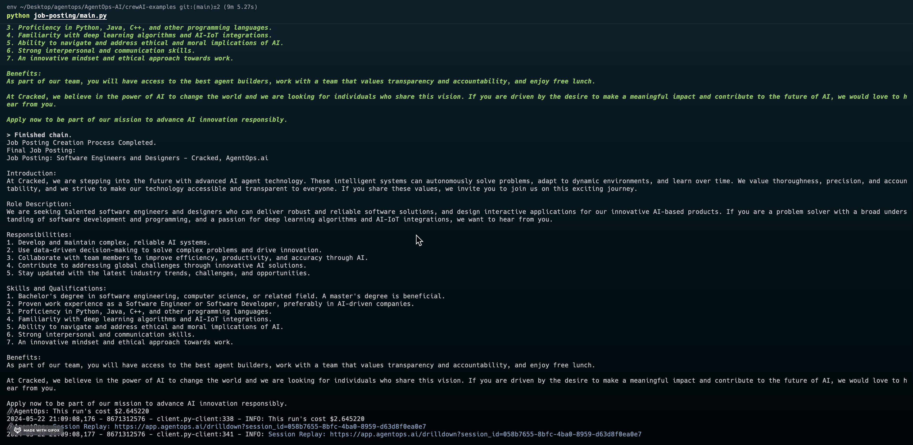

import CodeTooltip from '/snippets/add-code-tooltip.mdx'
import EnvTooltip from '/snippets/add-env-tooltip.mdx'

[Cohere](https://cohere.com) models can now be tracked with agentlens. Explore the [Cohere API](https://docs.cohere.com) for more information.

<Note>
  Cohere's [LLM University](https://cohere.com/llmu) is a great resource for learning about LLMs with a lot of hands on examples.
</Note>

<Card title="Cohere" icon="hill-rockslide" href="https://www.loom.com/share/679d65cc06f148299e8dffc459d053ab">
    First class support for Command-R-Plus
    
</Card>

# Steps to integrate Cohere with agentlens
<Steps>
  <Step title="Install the agentlens SDK">
    <CodeGroup>
      ```bash pip 
      pip install agentlens
      ```
      ```bash poetry
      poetry add agentlens
      ```
    </CodeGroup>
  </Step>
  <Step title="Install the Cohere SDK">
    <Note>
      `cohere>=5.4.0` is currently supported.
    </Note>
    <CodeGroup>
      ```bash pip
      pip install cohere
      ```
      ```bash poetry
      poetry add cohere
      ```
    </CodeGroup>
  </Step>
	<Step title="Add 3 lines of code">
    <CodeTooltip/>
		<CodeGroup>
			```python python
			import agentlens
			agentlens.init(<INSERT YOUR API KEY HERE>)
      co = cohere.Client()
			...
			# End of program (e.g. main.py)
			agentlens.end_session("Success") # Success|Fail|Indeterminate
			```
		</CodeGroup>
    <Warning>
      Requires `cohere>=5.4.0`
    </Warning>
		<EnvTooltip />
      <CodeGroup>
        ```python .env
        AGENTLENS_API_KEY=<YOUR API KEY>
        ```
      </CodeGroup>
      Read more about environment variables in [Advanced Configuration](/v1/usage/advanced-configuration)
	</Step>
  <Step title="Run your Agent">
		Execute your program and visit [app.github.com/jeansvaldez/agentlens/drilldown](http://localhost:3000/drilldown) to observe your Agent! 🕵️
		<Tip>
			After your run, agentlens prints a clickable url to console linking directly to your session in the Dashboard
		</Tip> 
		<div/>{/* Intentionally blank div for newline */}
		<Frame type="glass" caption="Clickable link to session">
			
		</Frame>
	</Step>
</Steps>

## Full Examples

<CodeGroup>
  ```python chat()
  import cohere
  import agentlens

  agentlens.init(<INSERT YOUR API KEY HERE>)

  co = cohere.Client()

  chat = co.chat(
      message="Is it pronounced ceaux-hear or co-hehray?"
  )

  print(chat)

  agentlens.end_session('Success')
  ```

  ```python chat_stream()
  import cohere
  import agentlens

  agentlens.init(<INSERT YOUR API KEY HERE>)

  co = cohere.Client()

  stream = co.chat_stream(
      message="Write me a haiku about the synergies between Cohere and agentlens"
  )

  for event in stream:
      if event.event_type == "text-generation":
          print(event.text, end='')

  agentlens.end_session('Success')
  ```
</CodeGroup>

<script type="module" src="/scripts/github_stars.js"></script>
<script type="module" src="/scripts/scroll-img-fadein-animation.js"></script>
<script type="module" src="/scripts/button_heartbeat_animation.js"></script>
<script type="css" src="/styles/styles.css"></script>
<script type="module" src="/scripts/adjust_api_dynamically.js"></script>
