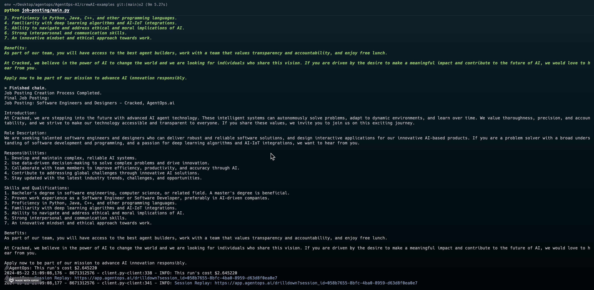

import CodeTooltip from '/snippets/add-code-tooltip.mdx'
import EnvTooltip from '/snippets/add-env-tooltip.mdx'

[LlamaIndex](https://www.llamaindex.ai/) is a framework for building context-augmented generative AI applications with LLMs. agentlens provides observability into your LlamaIndex applications through automatic instrumentation.

<Steps>
	<Step title="Install the agentlens SDK">
		<CodeGroup>
			```bash pip 
			pip install agentlens
			```
			```bash poetry
			poetry add agentlens
			```
		</CodeGroup>
	</Step>
	<Step title="Install LlamaIndex agentlens Instrumentation">
		<CodeGroup>
			```bash pip 
			pip install llama-index-instrumentation-agentlens
			```
			```bash poetry
			poetry add llama-index-instrumentation-agentlens
			```
		</CodeGroup>
	</Step>
	<Step title="Add 2 lines of code">
		<CodeTooltip/>
			<CodeGroup>
				```python python
				from llama_index.core import set_global_handler

				# NOTE: Feel free to set your agentlens environment variables (e.g., 'AGENTLENS_API_KEY')
				# as outlined in the agentlens documentation, or pass the equivalent keyword arguments
				# anticipated by agentlens' AOClient as **eval_params in set_global_handler.

				set_global_handler("agentlens")
				```
			</CodeGroup>
		<EnvTooltip />
      <CodeGroup>
        ```python .env
        AGENTLENS_API_KEY=<YOUR API KEY>
        ```
      </CodeGroup>
      Read more about environment variables in [Advanced Configuration](/v1/usage/advanced-configuration)
	</Step>
	<Step title="Run your LlamaIndex application">
		Execute your program and visit [app.github.com/jeansvaldez/agentlens/drilldown](http://localhost:3000/drilldown) to observe your LlamaIndex application! 🕵️
		<Tip>
			After your run, agentlens prints a clickable url to console linking directly to your session in the Dashboard
		</Tip> 
		<div/>{/* Intentionally blank div for newline */}
		<Frame type="glass" caption="Clickable link to session">
			
		</Frame>
	</Step>
</Steps>

## Usage Pattern

Here's a simple example of how to use agentlens with LlamaIndex:

```python
from llama_index.core import set_global_handler
import llama_index.core

# Set the global handler to agentlens
set_global_handler("agentlens")

# Your LlamaIndex application code here
# agentlens will automatically track LLM calls and other operations
```

## Additional Resources

For more detailed information about LlamaIndex's observability features and agentlens integration, check out the [LlamaIndex documentation](https://docs.llamaindex.ai/en/stable/module_guides/observability/#agentlens).

<script type="module" src="/scripts/github_stars.js"></script>
<script type="module" src="/scripts/scroll-img-fadein-animation.js"></script>
<script type="module" src="/scripts/button_heartbeat_animation.js"></script>
<script type="css" src="/styles/styles.css"></script>
<script type="module" src="/scripts/adjust_api_dynamically.js"></script>
